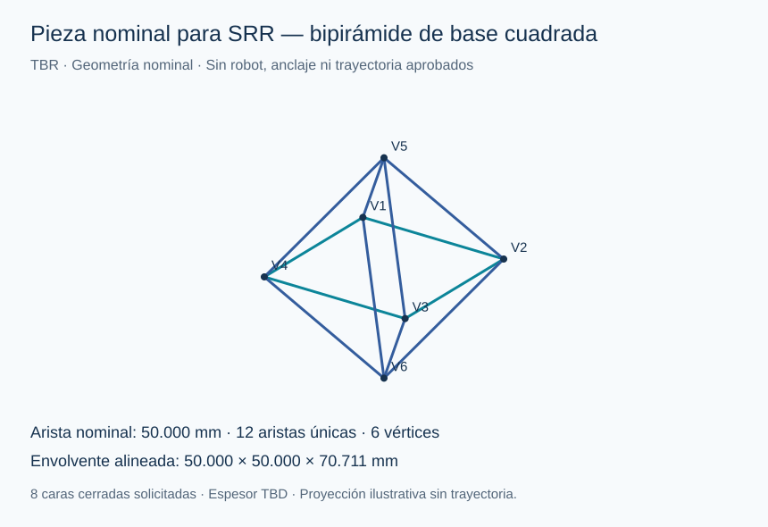

# Pieza nominal SRR-GEO-001

**TBR — geometría nominal, no comprobación de fabricabilidad.** Eidan confirmó base cuadrada, todas las aristas de 5 cm y aristas con caras cerradas. Referencia de parámetros: [caso SRR](../system/caso_srr.json).

## Derivación en SI

Sea a=0,05 m la longitud de cada arista. Los cuatro vértices de base son (±a/2,±a/2,0). Igualar la distancia de cada vértice a cada ápice con a da h=√(a²−a²/2)=a/√2.

Los ápices son (0,0,±h). Resultan 6 vértices, 12 aristas únicas y 8 caras triangulares equiláteras. La envolvente alineada es a×a×√2·a, nominalmente 0,05×0,05×0,0707107 m. La longitud total de aristas únicas es 0,6 m; **no es la longitud total de deposición de las caras**.

Las caras del OBJ representan superficies nominales de espesor cero. Espesor, construcción de paredes, tolerancias, contracción, uniones y estanqueidad están pendientes. Una malla cerrada no demuestra cierre físico ni resistencia.

## Archivos y reproducción

- [OBJ en metros](pieza_srr_bipiramide.obj): vértices, aristas y caras con orientación consistente.
- [SVG](pieza_srr_bipiramide.svg): proyección para revisión; no plano a escala.
- [Generador](../models/srr_integracion/geometria.py): usa exclusivamente el caso compartido.
- [Pruebas de geometría](../models/srr_integracion/test_geometria.py): longitudes, base, conectividad y cierre/orientación de caras.

Reproducir desde la raíz del repo con python models/srr_integracion/geometria.py. Los resultados son matemáticos bajo la geometría elegida, no una trayectoria de robot ni un CAD integrado.

## Uso por módulos

M1 propone anclaje, trayectorias para aristas y superficies y volumen barrido. M2 aporta espesor/material y condiciones de deposición. M3 estudia exposición y sombras en caras/uniones. M4 incorpora espacio de mecanismo/acceso. M5 define inspección de exterior/interior y regiones no observables.

El marco pieza_local_propuesto debe relacionarse con el mecanismo mediante una transformación revisada; no se asume posición real ni orientación de vuelo.
