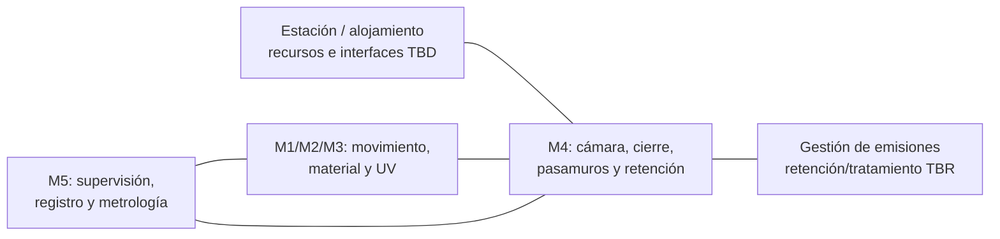

# Propuesta — M4: Cámara e integración

**Estado: TBR — propuesta conceptual para revisión.** Responsable de módulo: Shelton Yauri. Redacción: Codex a solicitud de Eidan, 12 de octubre de 2026. Rama: integracion/m4-m5-srr. Las conformidades de los módulos y del host siguen pendientes.

## Objetivo y escenario

Integrar una impresora de resina/UV candidata en una cámara dedicada dentro de una estación espacial con tripulación. Eidan eligió este escenario como referencia; el satélite queda como alternativa futura. No se ha elegido estación concreta, alojamiento, presión de trabajo, material ni equipo.

La cámara debe estudiarse como parte del sistema de contención y gestión de residuos. Su existencia no demuestra ausencia de exposición de la tripulación. No se dispone de una conexión aprobada al soporte vital ni al exterior.

## Geometría y envolvente

El caso nominal compartido es [SRR-GEO-001](../../system/caso_srr.json): bipirámide de base cuadrada, todas las aristas de 0,05 m, con aristas y caras cerradas solicitadas. La [geometría derivada](../../cad/pieza_srr.md) ocupa nominalmente 0,05 × 0,05 × 0,0707107 m en su marco local alineado.

Esa envolvente es solo la pieza nominal. La cámara debe incluir anclaje, soporte, recorrido del mecanismo, cabezal y tubos, inspección, ventanas, gestión de residuos, cierre y pasamuros. La orientación respecto al mecanismo y las holguras quedan pendientes de M1; no se asigna un tamaño de cámara arbitrario.

Las caras cerradas exigen revisar trayectoria de superficies, espesor, curado y posible gas atrapado al cerrar el volumen. El volumen geométrico encerrado no es volumen de material impreso ni demuestra que la pieza sea hermética.

## Alternativas de cámara y gases

| Concepto | Ventaja que se estudia | Límite / dato necesario | Estado |
|---|---|---|---|
| A: cámara confinada con retención y eventual tratamiento interno | Reduce dependencia inicial de una salida de gases del host; permite estudiar inventario y residuos localmente | Acumulación, capacidad de retención/tratamiento, temperatura, presión, fugas y apertura; eficacia por contaminante desconocida | TBR |
| B: cámara con transferencia controlada a una interfaz del host | Puede permitir gestionar emisiones sin almacenar todo dentro del payload | Requiere receptor, conexión, límites, aislamiento y respuesta ante fallo aceptados por el host; no se presume disponible | TBR |

**Propuesta de desarrollo:** usar A como concepto para el estudio inicial de contención, sin escoger todavía un filtro, válvula o cámara comercial. Mantener B condicionada a datos reales del alojamiento. Esto no es una selección de vuelo ni una aprobación de seguridad.

La NASA describe la identificación y cuantificación de emisiones de materiales en recintos habitables como parte de su evaluación de contaminación [S1]. Para este proyecto aún falta inventario/SDS del material y caracterización del proceso; no se atribuyen contaminantes ni límites toxicológicos a una resina desconocida.

## Arquitectura funcional propuesta

Separar físicamente funciones de proceso, acceso, observación y conexiones. Ventanas y pasamuros requieren compatibilidad química, óptica, térmica y de presión por definir. Cables/tubos deben seguir el recorrido del mecanismo sin crear tracción o interferencias no evaluadas.

## Recursos y costes

Mantener la fuente común en [presupuestos](../../system/presupuestos.md). No hay datos suficientes para publicar masa, potencia o coste de M4.

| Partida M4 | Información necesaria | Método inicial | Responsable de dato |
|---|---|---|---|
| Cámara, base y puerta | Dimensiones, material, espesor, sellos y cargas | Modelo de envolvente y masa por componentes; no diseño de recipiente a presión | M4 con M1/host |
| Ventanas y pasamuros | Transmisión óptica, química, juntas, conexiones | Fichas y compatibilidad por escenario | M4/M2/M3/M5 |
| Retención y gestión de gases | Emisiones, duración, capacidad y ruta | Balance por especie y evaluación de fallos | M2/M4 con host |
| Gestión térmica | Calor de UV/proceso/control y ruta al alojamiento | Balance temporal con condiciones del host | M3/M4/M5 |
| Integración y pruebas | Fabricación, inspección, ensayos y operación | Coste del ciclo de vida con fuente/fecha y exclusiones | M4/sistemas |

El [modelo paramétrico](analisis_contencion.md) ayuda a calcular cuando existan entradas. Un presupuesto con celdas desconocidas no se completa con cifras sin fuente.

## Condiciones de acceso y fallos

El acceso se define como una operación separada de impresión: terminación del proceso, gestión de presión/material/emisiones y autorización según el procedimiento aceptado. La geometría cerrada de la pieza también debe inspeccionarse antes de recuperación.

Evaluar cierre defectuoso, fuga, obstrucción/saturación, sobrepresión, UV/temperatura fuera de condiciones, desprendimiento y pérdida de energía. La respuesta no consiste automáticamente en apagar todo o abrir una salida. Las secuencias se proponen en [ICD-005](../../interfaces/ICD-005.md) y requieren datos M2/M3/host.

## Verificación y evidencias

- SRR: inspección del escenario y esquema, comparación de conceptos, inventario de peligros y modelos paramétricos. La geometría nominal se puede comprobar matemáticamente.
- PDR: dimensionamiento con datos de mecanismo/material/host, CAD integrado, rutas, presiones, calor y planes de prueba.
- Prototipo futuro: pruebas de contención, apertura, presión y compatibilidad según límites aprobados; caracterización de emisiones y eficacia de gestión cuando aplique.
- No se declara seguridad de tripulación, hermeticidad ni aptitud de vuelo verificadas.

## Revisión necesaria

| Interfaz | Pregunta concreta | Revisor | Estado |
|---|---|---|---|
| ICD-002 | ¿Qué volumen barrido, anclaje y carga exige imprimir aristas y caras? | M1 / NICOMANUQP | Pendiente |
| ICD-005 | ¿Qué material, inventario, emisiones y presión residual deben contenerse? | M2 / Gabriel | Pendiente |
| ICD-004/005 | ¿Qué calor, sombras, materiales ópticos y respuesta de parada exige UV? | M3 / responsable por asignar | Pendiente |
| ICD-003/005 | ¿Qué cobertura, ventanas, señales y autorización de acceso requiere M5? | Eidan / M5 | Pendiente |
| ICD-004 | ¿Qué alojamiento y rutas de gases/energía/calor están realmente disponibles? | Sistemas / host por definir | Pendiente |

Fuentes: [S1 — NASA Toxic Offgassing](https://www.nasa.gov/centers-and-facilities/white-sands/toxic-offgassing/), misión/caso compartido, requisitos, interfaces y decisiones de Eidan. Referencia NASA orientativa; aplicabilidad contractual TBD.

Seguimiento: [datos de cámara, emisiones y alojamiento](https://github.com/eidanYT/Aegins-Project/issues/3). Fecha de resolución y conformidades: por acordar.

Próximo avance: integrar datos del otro agente, elegir ruta de gases con el host y dimensionar la cámara sin confundir envolvente de pieza con espacio del mecanismo.
